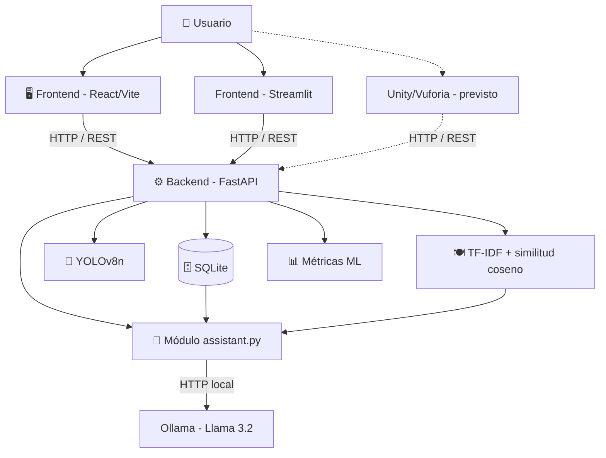
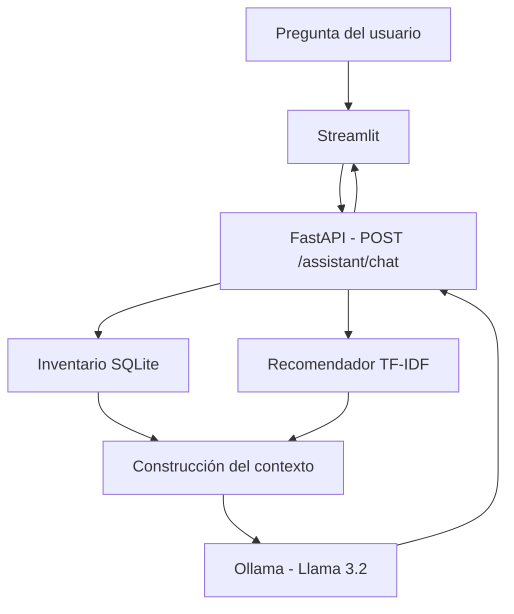

# 🧊 FridgAI

<div align="center">

### Tu nevera, ahora con inteligencia artificial 🤖

**Detecta ingredientes · Organiza tu nevera · Descubre recetas · Consulta tu asistente**


---

_Proyecto de Machine Learning y realidad aumentada aplicado a la gestión inteligente de alimentos._

</div>

## 📖 ¿Qué es FridgIA?

**FridgIA** es una aplicación que utiliza inteligencia artificial, visión por computador y aprendizaje automático para facilitar la gestión de alimentos, descubrir recetas y contribuir a reducir el desperdicio alimentario.

Permite reconocer ingredientes mediante imágenes, gestionar un inventario personal y recomendar recetas según los alimentos disponibles. La ampliación FridgIA Assistant incorpora un asistente conversacional contextualizado mediante Ollama y Llama 3.2.

La aplicación combina YOLOv8n, un recomendador basado en TF-IDF y similitud coseno, un backend FastAPI y un frontend React/Vite. También conserva una interfaz Streamlit orientada a la interacción y al análisis de los modelos. La integración con Unity y Vuforia forma parte del alcance previsto del proyecto.

## ✨ Funcionalidades principales

| Módulo                 | Descripción                                                                                                                   |
| ---------------------- | ----------------------------------------------------------------------------------------------------------------------------- |
| 📸 Escáner Visual      | Reconocimiento con YOLOv8n, subida de fotos, cámara web y visualización de bounding boxes                                     |
| 🥬 Mi Nevera           | Inventario persistente con cantidades, origen del ingrediente y gestión de productos                                          |
| 🍽️ Recetas y Favoritos | Recomendaciones del recetario, cobertura de ingredientes, filtros, detalles y favoritos                                       |
| 📊 Dashboard ML        | KPIs, comparativa de modelos, métricas YOLO y visualización del corpus                                                        |
| 🔐 Usuarios            | Registro, inicio y cierre de sesión mediante autenticación JWT                                                                |
| 🤖 Asistente de Cocina | Chat contextualizado con inventario y recetas, historial de sesión y tiempo de respuesta (Streamlit; pendiente de validación) |
| 🔗 API REST            | Comunicación entre clientes y backend mediante FastAPI                                                                        |
| 🥽 Realidad aumentada  | Visualización de recomendaciones mediante Unity y Vuforia (prevista)                                                          |

## 🛠️ Tecnologías utilizadas

| Categoría                     | Tecnologías                           |
| ----------------------------- | ------------------------------------- |
| Lenguaje                      | Python 3.12                           |
| Frontend principal            | React, Vite, JavaScript               |
| UI React                      | Lucide React, Framer Motion, Recharts |
| Frontend alternativo          | Streamlit, Plotly                     |
| Entorno JavaScript            | Node.js, npm                          |
| Backend                       | FastAPI, Uvicorn, Pydantic, requests  |
| Visión artificial             | YOLOv8n, Ultralytics, OpenCV          |
| Machine Learning              | scikit-learn, scikit-image            |
| NLP y recomendación           | TF-IDF, similitud coseno              |
| IA generativa                 | Ollama, Llama 3.2 (chatbot)           |
| Procesamiento de datos        | NumPy, Pandas, SciPy                  |
| Base de datos                 | SQLite                                |
| Autenticación                 | JWT, bcrypt                           |
| Realidad aumentada (prevista) | Unity, Vuforia, C#                    |
| Control de versiones          | Git, GitHub, Git LFS                  |

## 🏗️ Arquitectura



**Funcionamiento general:**

1. El usuario interactúa con React o Streamlit.
2. El frontend realiza solicitudes HTTP a FastAPI, incluyendo el token JWT cuando corresponde.
3. FastAPI utiliza los modelos entrenados y SQLite para procesar las peticiones.
4. En el chatbot de Streamlit, el backend recupera el inventario del usuario y las recomendaciones del recetario para contextualizar la consulta enviada a Ollama.
5. Los resultados se muestran en la interfaz correspondiente. Unity y Vuforia podrán consumir la misma API en la futura integración de RA.

## 📂 Estructura del proyecto

```text
FridgIA/
├── artifacts/              # Modelos entrenados y métricas
├── backend/
│   ├── main.py             # Endpoints FastAPI
│   ├── database.py         # Persistencia SQLite
│   ├── auth.py             # Autenticación
│   ├── schemas.py          # Esquemas Pydantic
│   ├── ml_engine.py        # Inferencia y recomendación
│   └── assistant.py        # Nueva integración con Ollama
├── data/                   # Datos y recetas procesadas
├── datasets/               # Imágenes y etiquetas YOLO
├── frontend/
│   └── app.py              # Streamlit, incluido el chatbot
├── frontend-react/
│   ├── src/
│   │   ├── App.jsx
│   │   ├── main.jsx
│   │   └── styles.css
│   ├── index.html
│   └── package.json
├── ml/                     # Entrenamiento y evaluación ML
├── yolo_entrega/           # Archivos de entrega YOLO
├── script.py
├── requirements.txt
├── .gitignore
├── .gitattributes
└── README.md
```

La estructura incluye la ampliación propuesta del chatbot; los cambios deben incorporarse a la rama correspondiente antes de integrarlos en `main`.

## 🚀 Instalación y ejecución

Instrucciones para Windows (PowerShell) y macOS (Terminal o Visual Studio Code). Ejecuta los comandos desde la raíz de FridgIA salvo cuando se indique lo contrario.

### 1. Requisitos previos

Es necesario tener instalado:

- [Python 3.12](https://www.python.org/downloads/)
- [Git](https://git-scm.com/)
- [Git LFS](https://git-lfs.com/)
- [Node.js y npm](https://nodejs.org/) (para React/Vite; versión compatible con el proyecto)
- [Ollama](https://ollama.com/download) (para el chatbot)
- Visual Studio Code (recomendado)

Comprueba las herramientas:

```bash
git --version
git lfs version
node --version
npm --version
ollama --version
```

En macOS, si dispones de Homebrew, puedes instalar Python y Git LFS con:

```bash
brew install python@3.12 git-lfs
```

### 2. Clonar el repositorio

**Windows (PowerShell):**

```powershell
git lfs install
git -c core.longpaths=true clone https://github.com/Llarkruks/FridgIA.git
cd FridgIA
git lfs pull
```

**macOS:**

```bash
git lfs install
git clone https://github.com/Llarkruks/FridgIA.git
cd FridgIA
git lfs pull
```

Git LFS permite descargar los archivos grandes del dataset y los modelos entrenados.

### 3. Crear y activar el entorno virtual

**Windows:**

```powershell
py -3.12 -m venv .venv
.\.venv\Scripts\Activate.ps1
```

Si PowerShell bloquea la activación:

```powershell
Set-ExecutionPolicy -Scope Process -ExecutionPolicy Bypass
.\.venv\Scripts\Activate.ps1
```

**macOS:**

```bash
python3.12 -m venv .venv
source .venv/bin/activate
```

### 4. Instalar las dependencias Python

Con el entorno virtual activado:

```bash
python --version
python -m pip install --upgrade pip
python -m pip install -r requirements.txt
python -m pip check
```

Si faltan las dependencias `pyarrow` o `cachetools`, instalarlas explícitamente y revisar su incorporación a `requirements.txt`:

```bash
python -m pip install pyarrow cachetools
```

No es necesario volver a entrenar los modelos para ejecutar la aplicación si todos los artefactos están disponibles.

### 5. Preparar Ollama (solo para el chatbot)

Abre Ollama o ejecuta en una terminal independiente:

```bash
ollama serve
```

Si ya está ejecutándose, no inicies una segunda instancia.

Comprueba los modelos disponibles:

```bash
ollama list
```

Si no aparece `llama3.2`, descárgalo desde otra terminal:

```bash
ollama pull llama3.2
```

Prueba el modelo:

```bash
ollama run llama3.2
```

Introduce una pregunta y utiliza `/bye` para salir de la conversación.

Mantén el servicio Ollama activo. Su API local utiliza el puerto 11434.

### 6. Iniciar el backend FastAPI

En una terminal situada en la raíz del proyecto, con `.venv` activado:

```bash
python -m uvicorn backend.main:app --host 127.0.0.1 --port 8000
```

Espera a que aparezca `Application startup complete`. El arranque carga los modelos y el recetario en memoria.

- Backend: http://127.0.0.1:8000
- Estado: http://127.0.0.1:8000/health
- Swagger UI: http://127.0.0.1:8000/docs

Mantén esta terminal abierta.

Se puede añadir `--reload` durante el desarrollo si funciona correctamente en el entorno local.

### 7. Iniciar el frontend React/Vite

En una nueva terminal:

```bash
cd frontend-react
npm install
npm run dev
```

Abre:

**http://localhost:5173**

O la URL que indique Vite.

FastAPI debe seguir ejecutándose en el puerto 8000.

No es necesario activar el entorno virtual Python para ejecutar React.

El chatbot de esta ampliación aún no está integrado en React.

### 8. Iniciar el frontend Streamlit

Abre otra terminal situada en la raíz de FridgIA.

**Windows:**

```powershell
.\.venv\Scripts\Activate.ps1
python -m streamlit run frontend/app.py
```

**macOS:**

```bash
source .venv/bin/activate
python -m streamlit run frontend/app.py
```

Abre:

**http://localhost:8501**

Inicia sesión y selecciona el módulo deseado.

Para utilizar el nuevo asistente, selecciona **Asistente de Cocina** una vez incorporados los cambios y comprueba que Ollama está activo.

### 9. Resumen de servicios

| Servicio   | Puerto | Necesario para                       |
| ---------- | ------ | ------------------------------------ |
| FastAPI    | 8000   | Ambos frontends                      |
| React/Vite | 5173   | Interfaz React                       |
| Streamlit  | 8501   | Interfaz Streamlit y chatbot         |
| Ollama     | 11434  | Generación de respuestas del chatbot |

React y Streamlit pueden ejecutarse simultáneamente, pero no es obligatorio.

Cada servicio debe permanecer activo mientras se utilice.

## 🧠 Machine Learning y recomendación

### Reconocimiento visual

FridgIA utiliza YOLOv8n para detectar varios ingredientes en una misma imagen, devolviendo clases, confianza y bounding boxes.

La memoria documenta una comparativa previa de clasificadores clásicos mediante características visuales y validación cruzada:

- K-Nearest Neighbors (KNN).
- Decision Tree.
- Gaussian Naive Bayes.
- Multilayer Perceptron (MLP).
- Support Vector Machine (SVM).
- Random Forest.
- HistGradientBoosting.

| Métrica documentada                     | Resultado |
| --------------------------------------- | --------: |
| Accuracy del mejor clasificador clásico |   72,90 % |
| YOLO mAP@50                             |   76,39 % |
| YOLO mAP@50–95                          |   54,39 % |
| YOLO Precision                          |   75,67 % |
| YOLO Recall                             |   71,84 % |

Estos resultados proceden de la memoria del proyecto. Accuracy y mAP corresponden a tareas diferentes y no son directamente comparables.

### Recomendador de recetas

El sistema normaliza los ingredientes del recetario, unifica sinónimos y vectoriza las recetas mediante TF-IDF.

A continuación, calcula la similitud coseno entre el inventario y las recetas y aplica una puntuación híbrida:

```text
Score = 0.60 × cobertura de ingredientes + 0.40 × similitud coseno
```

El recomendador devuelve recetas existentes, ingredientes coincidentes y faltantes.

El vocabulario canónico actual de 57 ingredientes limita la cobertura real: una coincidencia del 100 % no garantiza que estén disponibles todos los ingredientes originales ni sus cantidades.

### Datasets

| Dataset                                                                              | Fuente            | Uso                                                                                                  |
| ------------------------------------------------------------------------------------ | ----------------- | ---------------------------------------------------------------------------------------------------- |
| [Community Recipe Dataset](https://zenodo.org/records/4681803)                       | Zenodo            | Recetario en español: 12.641 registros originales y 10.713 recetas tras el procesamiento documentado |
| [Fridge Dataset](https://universe.roboflow.com/practicum-ziryz/fridge-dataset-oi7ld) | Roboflow Universe | Imágenes anotadas de alimentos para detección de objetos                                             |
| [VegeNet](https://zenodo.org/records/7254508)                                        | Zenodo            | Alternativa evaluada y descartada por su limitada cobertura de ingredientes                          |

Zenodo aparece entre las fuentes recomendadas en el enunciado docente. El uso de Roboflow debe confirmarse con la profesora si exige utilizar exclusivamente las fuentes enumeradas.

## 🤖 FridgIA Assistant

El nuevo módulo permite consultar recetas mediante lenguaje natural. Se ha diseñado para reutilizar el recomendador existente, sin entrenar un nuevo modelo generativo.

A diferencia de un chatbot convencional, FridgIA Assistant recibe información sobre los ingredientes almacenados en la nevera del usuario y las recetas recuperadas por el sistema de recomendación.

### Funcionamiento

1. El usuario escribe una pregunta en Streamlit mediante `st.chat_input`.
2. El frontend llama al endpoint autenticado `POST /assistant/chat`.
3. FastAPI recupera el inventario del usuario desde SQLite y hasta cinco recetas del recomendador.
4. `backend/assistant.py` construye el contexto con inventario, recetas y mensajes recientes y realiza una petición a la API local de Ollama (`/api/chat`).
5. Llama 3.2 genera una respuesta en español y el frontend muestra el texto, el tiempo de generación y las recetas consultadas.



Esta arquitectura es una aproximación básica a la generación aumentada por recuperación (RAG). Las recetas recuperadas sirven de contexto, pero el modelo generativo puede cometer errores.

### Funcionalidades del chatbot

- Consultas sobre los ingredientes disponibles y las recetas recomendadas.
- Explicación de instrucciones y posibles ingredientes faltantes.
- Historial durante la sesión mediante `st.session_state` y `st.chat_message`.
- Botón para iniciar una nueva conversación.
- Limpieza del historial al cerrar sesión.
- Medición del tiempo de generación.
- Visualización de las recetas consultadas.
- Manejo de errores de conexión con Ollama.

### Ejemplos de consultas

- ¿Qué puedo cocinar hoy con los ingredientes de mi nevera?
- ¿Qué recetas puedo preparar sin tener que ir a comprar?
- ¿Qué ingredientes me faltan para preparar esta receta?
- ¿Cómo preparo la primera receta recomendada?
- ¿Cómo puedo aprovechar los alimentos que tengo disponibles?

El historial conversacional no se guarda todavía de forma permanente en SQLite.

La persistencia del inventario y los favoritos se realiza mediante el backend existente. No debe utilizarse el chatbot como garantía de seguridad alimentaria o de ausencia de alérgenos.

## 🔗 API REST

| Método       | Endpoint                 | Función                                              |
| ------------ | ------------------------ | ---------------------------------------------------- |
| GET          | `/health`                | Estado del servidor                                  |
| POST         | `/register`              | Registro                                             |
| POST         | `/token`                 | Autenticación                                        |
| POST         | `/recognize`             | Detección de ingredientes                            |
| GET / POST   | `/fridge/items`          | Consulta y alta de ingredientes                      |
| PUT / DELETE | `/fridge/items/{id}`     | Edición y eliminación                                |
| POST         | `/recommend`             | Recomendación personalizada                          |
| GET          | `/recommend/from-fridge` | Recomendación desde el inventario                    |
| GET          | `/recipes/{id}`          | Detalle de receta                                    |
| GET / POST   | `/favorites`             | Consulta y alta de favoritos                         |
| DELETE       | `/favorites/{id}`        | Eliminación de favoritos                             |
| GET          | `/categories`            | Categorías culinarias                                |
| GET          | `/ml/metrics`            | Métricas ML                                          |
| GET          | `/scans/recent`          | Historial de escaneos                                |
| POST         | `/assistant/chat`        | Nuevo endpoint del chatbot (pendiente de validación) |

### Ejemplo de petición al chatbot

El endpoint requiere autenticación mediante JWT.

```json
{
  "messages": [
    {
      "role": "user",
      "content": "¿Qué puedo cocinar con lo que tengo en mi nevera?"
    }
  ]
}
```

La documentación interactiva de todos los endpoints está disponible en:

**http://127.0.0.1:8000/docs**

## 📊 Interfaz Streamlit y requisitos docentes

La interfaz de Streamlit incorpora elementos interactivos orientados tanto al usuario final como al análisis de los modelos de Machine Learning.

| Elemento               | Justificación                                                                                                        |
| ---------------------- | -------------------------------------------------------------------------------------------------------------------- |
| Visualización de datos | Dashboard de métricas, gráficos y matrices de confusión                                                              |
| Widgets                | Captura de imágenes, filtros, formularios, botones y entrada de chat                                                 |
| Chatbot                | Asistente culinario contextualizado con el inventario                                                                |
| Estado de sesión       | Mantener autenticación e historial durante la interacción                                                            |
| Caché                  | Evitar recálculos; caché del recomendador en backend y caché de datos públicos en Streamlit prevista o por verificar |
| Persistencia           | Inventario y favoritos almacenados en SQLite entre sesiones                                                          |

## 👥 Trabajo en equipo

Para colaborar en el proyecto:

1. Clona el repositorio y prepara el entorno.
2. Crea una rama para desarrollar tus cambios.
3. Revisa y prueba las modificaciones.
4. Realiza commits descriptivos y sube la rama a GitHub.
5. Abre una Pull Request para revisar e integrar los cambios.

Ejemplo:

```bash
git switch -c feature/nueva-funcionalidad
git status
git add <archivos-modificados>
git commit -m "feat: añadir nueva funcionalidad"
git push -u origin feature/nueva-funcionalidad
```

**Buenas prácticas:**

- No subir entornos virtuales (`.venv`, `.venv-1`).
- No subir la carpeta `node_modules`.
- No subir bases de datos locales con datos personales.
- No subir contraseñas ni archivos `.env` con secretos.
- Mantener actualizado `requirements.txt`.
- Utilizar Git LFS para los archivos grandes correspondientes.
- Revisar los cambios antes de integrarlos en `main`.

## 🔧 Solución de problemas

### Error `Filename too long` al clonar (Windows)

Habilita las rutas largas para Git antes de clonar:

```powershell
git config --global core.longpaths true
```

### El frontend no conecta con FastAPI

Comprueba que Uvicorn está ejecutándose en el puerto 8000 y que ha terminado de cargar los modelos.

Abre:

http://127.0.0.1:8000/health

Si el servidor no responde, revisa los mensajes de la terminal del backend.

### Error `KeyboardInterrupt` durante el arranque

Este mensaje indica que el proceso ha sido interrumpido.

Reinicia Uvicorn sin el parámetro `--reload` y deja que complete el arranque:

```bash
python -m uvicorn backend.main:app --host 127.0.0.1 --port 8000
```

### Error `No module named python`

Comprueba que los comandos de instalación utilizan la sintaxis correcta:

```bash
python -m pip install -r requirements.txt
```

No utilizar `python -m python -m pip`.

### Entornos virtuales duplicados

Activar el entorno virtual `.venv` y comprobar el intérprete de Python.

En macOS:

```bash
which python
```

En Windows:

```powershell
Get-Command python
```

### Faltan librerías Python

Comprueba que el entorno virtual está activado y ejecuta:

```bash
python -m pip install -r requirements.txt
```

### No aparecen los archivos grandes del dataset

Ejecuta desde el repositorio:

```bash
git lfs pull
```

### Error `npm: command not found`

Instala Node.js y npm antes de ejecutar el frontend React.

### Ollama no responde

Comprueba que Ollama está abierto o ejecuta:

```bash
ollama serve
```

Comprueba los modelos instalados:

```bash
ollama list
```

### No se encuentra el modelo Llama 3.2

Descarga el modelo:

```bash
ollama pull llama3.2
```

### El puerto 11434 está ocupado

Es posible que Ollama ya esté ejecutándose.

Comprueba si responde su API:

http://127.0.0.1:11434/api/tags

### El chatbot tarda en responder

La primera consulta puede requerir cargar el modelo generativo en memoria.

Comprueba que Ollama está funcionando correctamente y revisa los tiempos de espera configurados en el backend y el frontend.

## 📌 Estado del proyecto

- ✅ Repositorio GitHub disponible.
- ✅ Preparación, entrenamiento y evaluación de los modelos documentados.
- ✅ Recomendador de recetas desarrollado.
- ✅ Backend FastAPI desarrollado.
- ✅ Inventario y favoritos con persistencia SQLite implementados.
- ✅ Frontend React/Vite disponible.
- ✅ Frontend Streamlit disponible.
- ✅ Ejecución y comunicación entre Streamlit y FastAPI comprobadas.
- 🔄 Chatbot contextualizado con Ollama: ampliación pendiente de integración y validación completa.
- 🔄 Validación funcional completa de los módulos.
- 🔄 Evaluación del rendimiento del chatbot.
- ⏳ Integración del chatbot en React.
- ⏳ Integración de realidad aumentada mediante Unity y Vuforia.

---

<div align="center">

### 🧊 FridgIA

**Inteligencia artificial aplicada a una nevera más inteligente.**

Desarrollado como proyecto colaborativo de Machine Learning y realidad aumentada.

</div>
