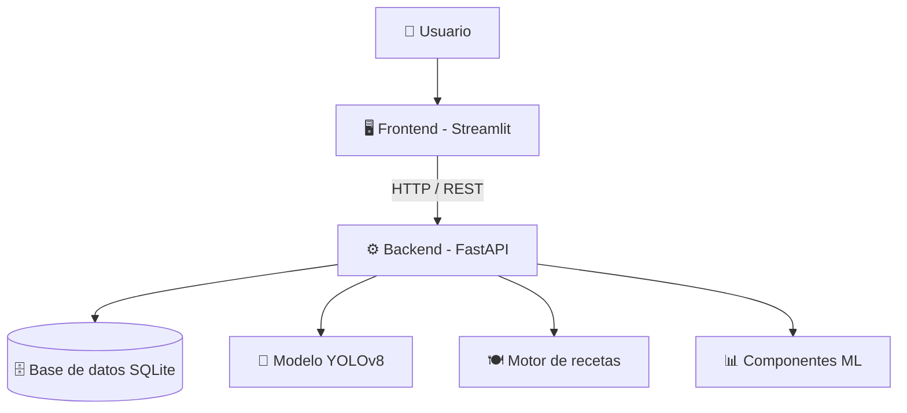

# 🧊 FridgIA

<div align="center">

### Tu nevera, ahora con inteligencia artificial 🤖

**Detecta ingredientes · Organiza tu nevera · Descubre recetas**


---

*Proyecto de inteligencia artificial aplicado al reconocimiento de alimentos y la gestión inteligente de ingredientes.*

</div>

## 📖 ¿Qué es FridgIA?

**FridgIA** es una aplicación que utiliza técnicas de inteligencia artificial, visión por computador y aprendizaje automático para facilitar la gestión de alimentos y la exploración de recetas.

A través de una interfaz web, permite reconocer ingredientes mediante imágenes, gestionar los alimentos disponibles y consultar recetas.

La aplicación combina un modelo **YOLOv8n**, un backend desarrollado con **FastAPI** y un frontend interactivo construido con **Streamlit**.

## ✨ Funcionalidades principales

| Módulo | Descripción |
|---|---|
| 📸 Escáner Visual | Reconocimiento de ingredientes mediante YOLOv8 |
| 🥬 Mi Nevera | Gestión de los ingredientes disponibles |
| 🍽️ Recetas y Favoritos | Exploración de recetas y gestión de favoritos |
| 📊 Dashboard ML | Visualización de resultados relacionados con los modelos de aprendizaje automático |
| 🔐 Usuarios | Registro e inicio de sesión |
| 🔗 API REST | Comunicación entre frontend y backend mediante FastAPI |

## 🛠️ Tecnologías utilizadas

| Categoría | Tecnologías |
|---|---|
| Lenguaje | Python 3.12 |
| Frontend | Streamlit, Plotly |
| Backend | FastAPI, Uvicorn |
| Visión artificial | YOLOv8n, Ultralytics, OpenCV |
| Machine Learning | scikit-learn, scikit-image |
| Procesamiento de datos | NumPy, Pandas, SciPy |
| Base de datos | SQLite |
| Control de versiones | Git, GitHub y Git LFS |

## 🏗️ Arquitectura



**Funcionamiento general:**

1. El usuario interactúa con la aplicación Streamlit.
2. El frontend realiza solicitudes HTTP al backend.
3. FastAPI procesa las peticiones y utiliza los componentes necesarios.
4. La aplicación devuelve los resultados al usuario.

## 📂 Estructura del proyecto

```text
FridgIA/
│
├── artifacts/          # Recursos y artefactos del proyecto
├── backend/            # API y lógica de negocio
├── data/               # Datos utilizados por la aplicación
├── datasets/           # Dataset de imágenes y etiquetas YOLO
├── frontend/
│   └── app.py          # Interfaz web Streamlit
├── ml/                 # Código de Machine Learning
├── yolo_entrega/       # Archivos de entrega de YOLO
│
├── script.py           # Script adicional
├── requirements.txt    # Dependencias Python
├── .gitignore
├── .gitattributes
└── README.md
```

## 🚀 Instalación y ejecución

Estas instrucciones están pensadas para **Windows con PowerShell y Visual Studio Code**.

### 1. Requisitos previos

Es necesario tener instalado:

- Python 3.12
- Git
- Git LFS
- Visual Studio Code (recomendado)

> **Nota para Windows:** algunos archivos del dataset tienen rutas largas. Por ello, es importante habilitar `core.longpaths` antes de clonar.

### 2. Clonar el repositorio

Abre una terminal y ejecuta:

```powershell
git lfs install
git -c core.longpaths=true clone https://github.com/Llarkruks/FridgIA.git
cd FridgIA
```

Git LFS permite descargar las imágenes y los modelos de mayor tamaño.

### 3. Crear un entorno virtual

```powershell
py -3.12 -m venv .venv
```

Activar el entorno:

```powershell
.\.venv\Scripts\Activate.ps1
```

Si PowerShell bloquea la activación:

```powershell
Set-ExecutionPolicy -Scope Process -ExecutionPolicy Bypass
.\.venv\Scripts\Activate.ps1
```

### 4. Instalar las dependencias

```powershell
python -m pip install --upgrade pip
python -m pip install -r requirements.txt
```

Comprobar la instalación:

```powershell
python -m pip check
```

### 5. Iniciar el backend

Desde la raíz del proyecto, con el entorno virtual activado:

```powershell
python -m uvicorn backend.main:app --reload --port 8000
```

Backend:

**http://127.0.0.1:8000**

Documentación interactiva de la API:

**http://127.0.0.1:8000/docs**

Mantén esta terminal abierta.

### 6. Iniciar el frontend

Abre una **segunda terminal**, activa el entorno virtual y ejecuta:

```powershell
.\.venv\Scripts\Activate.ps1
python -m streamlit run frontend/app.py
```

La aplicación estará disponible en:

**http://localhost:8501**

> ⚠️ Es necesario mantener ambos servidores ejecutándose para utilizar las funcionalidades que dependen del backend.

### 7. Versión React/Vite del frontend

El proyecto también incluye una interfaz moderna desarrollada con React y Vite en `frontend-react/`.

Desde una nueva terminal, instala las dependencias y inicia el servidor:

```powershell
cd frontend-react
npm install
npm run dev
```

El frontend React estará disponible en:

**http://127.0.0.1:5173**

FastAPI debe seguir ejecutándose en el puerto `8000`.

## 🧠 Modelo de inteligencia artificial

FridgIA incorpora un modelo **YOLOv8n** para el reconocimiento visual de ingredientes.

El proyecto incluye un dataset organizado para tareas de visión artificial, con imágenes y sus correspondientes etiquetas.

La aplicación utiliza también componentes de aprendizaje automático desarrollados con scikit-learn.

## 👥 Trabajo en equipo

Para colaborar en el proyecto:

1. Clona el repositorio y prepara tu entorno.
2. Crea una rama para desarrollar tus cambios.
3. Realiza commits claros y descriptivos.
4. Sube tu rama a GitHub.
5. Abre una Pull Request para revisar e integrar las modificaciones.

Ejemplo:

```bash
git switch -c feature/nueva-funcionalidad
git add .
git commit -m "feat: añadir nueva funcionalidad"
git push -u origin feature/nueva-funcionalidad
```

**Buenas prácticas:**

- No subir entornos virtuales (`.venv`).
- No subir contraseñas ni archivos `.env` con secretos.
- Mantener actualizado `requirements.txt`.
- Usar Git LFS para los archivos grandes correspondientes.
- Revisar los cambios antes de integrarlos en `main`.

## 🔧 Solución de problemas

**Error `Filename too long` al clonar**

Habilita las rutas largas para Git antes de clonar:

```powershell
git config --global core.longpaths true
```

**El frontend no conecta con FastAPI**

Comprueba que Uvicorn está ejecutándose en el puerto `8000`.

**Faltan librerías Python**

Comprueba que el entorno virtual está activado y ejecuta:

```powershell
python -m pip install -r requirements.txt
```

**No aparecen los archivos grandes del dataset**

Ejecuta desde el repositorio:

```powershell
git lfs pull
```

## 📌 Estado del proyecto

✅ Repositorio GitHub disponible

✅ Instalación de dependencias comprobada

✅ Frontend y backend iniciados correctamente

✅ Comunicación entre Streamlit y FastAPI comprobada

🔄 Validación funcional completa de los módulos pendiente

---

<div align="center">

### 🧊 FridgIA

**Inteligencia artificial aplicada a una nevera más inteligente.**

Desarrollado como proyecto colaborativo de inteligencia artificial.

</div>